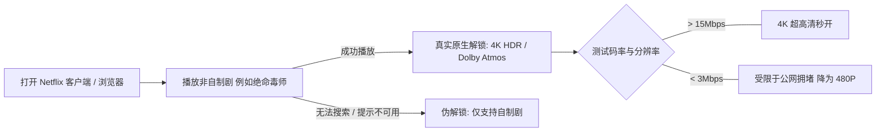

随着 OpenAI、Anthropic、Google DeepMind 等前沿人工智能巨头以及 Netflix、Disney+、HBO Max 等顶级流媒体平台在边缘安全与风控对抗领域的持续升级，越来越多的网络使用者经常遭遇以下令人崩溃的报错：

- 访问 ChatGPT 提示 `Access Denied` 或直接弹出 **1020 拒绝访问 / 403 Forbidden**；
- 注册或使用 Claude 时，即便通过了验证码，仍频繁强制弹出手机号二次短信验证，甚至数天内账号被无故封禁；
- 登录 Netflix 发现搜索不到非自制剧（如各类地区独播动漫与院线大片），且播放画质被平台强制锁死在 **480P 模糊状态**；
- TikTok 运营视频长期处于 0 播放状态，海外直播推流频繁遭遇算法隐性限流。

造成上述问题的根源，是平台风控雷达检测到了您所使用的网络出口存在严重的**数据中心（Hosting）特征、高欺诈分（Fraud Score）污染以及本地环境泄漏**。

本指南将深入拆解主流平台的风控判定机制，并指导您结合 [Nexitally 官方网站](/) 的原生专线网络与客户端规则，打造无惧风控的纯净高速工作流。

---

## 核心速查（Answer Block）

> **问题：为什么开启了代理软件，访问 ChatGPT 依然提示 1020 报错，或使用 Claude 账号频繁被封？如何彻底根治？**  
> **答案：** 核心原因在于三个层面：  
> 1. **出口 IP 类型暴露**：普通机场使用的是廉价机房 IP（如 AWS、DigitalOcean 等 Hosting ASN），已被 Cloudflare Turnstile 标记为高风险代理池；  
> 2. **DNS 泄漏严重**：客户端在发起请求时，域名解析仍通过本地运营商 DNS（如 114.114.114.114）进行，导致平台检测到请求 IP 与 DNS 归属地严重冲突；  
> 3. **节点延迟与时区指纹错配**。  
> **根治方案**：在客户端配置中开启 **远程 DNS 解析防泄漏**，并将 AI 流量精准分流至具备**原生本土 IP 广播**的专线节点（推荐 Nexitally 美西、美东或新加坡核心专线），避免全局代理导致的本地网络环境紊乱。用户可在 [专线资费中心](/pricing) 选择包含优质 AI/流媒体支持的套餐方案。

---

## 一、海外平台风控识别代理的四大底层机制

各大海外科技巨头并非通过“人工审核”识别代理，而是由边缘安全网关（如 Cloudflare、Akamai、DataDome）依据一套多维度的算法自动打分：

```mermaid
graph TD
    UserTraffic[用户访问请求] --> Gateway[边缘风控防火墙 (Cloudflare / Akamai)]
    
    Gateway --> Check1{检查一：ASN 类型识别}
    Check1 -- Hosting 数据中心 IP --- Flag1[欺诈分 +50: 判定为公共代理]
    Check1 -- Residential / Business 原生宽带 --- Pass1[信任度高: 正常放行]
    
    Gateway --> Check2{检查二：并发行为与黑名单}
    Check2 -- 同一IP数千人同时访问 --- Flag2[触发 1020 / 人机验证码循环]
    Check2 -- 纯净长效会话 --- Pass2[正常放行]
    
    Gateway --> Check3{检查三：DNS 与 WebRTC 泄漏}
    Check3 -- 探测到中国本地 DNS --- Flag3[触发地理封锁直接拦截]
    Check3 -- 远程加密 DNS 一致 --- Pass3[正常放行]
    
    Flag1 & Flag2 & Flag3 --> Deny[拦截: Access Denied / 降画质 / 封号]
    Pass1 & Pass2 & Pass3 --> Success[秒开: 4K HDR / ChatGPT流畅对话]
```

### 1. ASN 属性归属分类（数据中心 vs 原生住宅）
每个公网 IP 地址都隶属于一个自治系统（ASN）。如果您的 IP 隶属于机房托管商，风控数据库会直接将其列为“商业代理出口”。相反，如果 IP 属于当地正规电信运营商的商业或宽带住宅段（如 AT&T、Verizon、HKT），平台就会将其判定为普通家庭或企业真实用户。

### 2. IP 欺诈分与邻居污染（Fraud Score）
在 IPQS、Scamalytics、MaxMind 等风控数据库中，每个 IP 都有一个从 0 到 100 的欺诈分：
- **普通中转机场**：一个 IP 被数千人甚至数万人共用，其中只要有人从事批量爬虫或违规操作，该 IP 及其整个 C 段子网就会被风控库全量标记为“极度危险（Fraud Score 80+）”，导致所有正常用户连带“躺枪”。
- **Nexitally 原生广播池**：精选纯净广播资源，配合 [全节点 1 倍率机制](/pricing) 动态均衡负载，保持出口 IP 的低并发与长效健康度。

### 3. DNS 污染与 WebRTC 真实 IP 泄漏
即使出站流量走通了代理，如果您的浏览器在握手时通过 WebRTC 暴露了内网真实 IP，或者系统解析 `api.openai.com` 时请求了本地电信/联通 DNS，风控引擎会在 1 毫秒内捕获这种“出站 IP 与 DNS 属地不一致”的硬伤并直接下发拦截令牌。

---

## 二、前沿 AI 工具（ChatGPT / Claude / Perplexity）连接与防封实战

要在高强度的开发与日常办公中稳定调用大模型，请严格遵循以下规则：

### 1. 突破 ChatGPT 1020 报错与频繁验证码
- **首选节点群**：在 [客户端安装与配置教程](/blog/client-setup-guide/) 中导入订阅后，优先选择 `🇺🇸 美国核心专线` 或 `🇸🇬 新加坡核心专线`。
- **清除浏览器本地残留标记**：如果某个浏览器已触发过 1020 报错，Cloudflare 会在本地植入一个持久化的 `cf_clearance` 拦截 Cookie。此时直接更换节点依然会报错。必须在浏览器设置中清除 `chatgpt.com` 与 `openai.com` 的全部 Cookies 与网站缓存数据，或在隐身无痕模式下重新打开。

### 2. 避免 Claude 账号被封的关键操作守则
Anthropic 拥有业内最激进的风控模型，其对“IP 频繁跨国漂移”容忍度极低：
- **固定单国节点**：切忌在上午用香港节点、下午用美国节点、晚上切到日本节点使用同一个 Claude 账号。建议为 Claude 设定专门的固定节点（如美东或美西）。
- **杜绝免费或万人节点**：绝不使用任何公用免费节点登录您的主力商业账户。
- **配合轻量协议长效保活**：由于 Claude 包含长篇代码生成与复杂长文本输入，依托 [现代化 VLESS 协议的低开销连接](/blog/vless-protocol-advantages/) 能有效避免生成过程中的瞬时断连。

---

## 三、Netflix / Disney+ / YouTube Premium 4K HDR 极速秒开秘籍

在享受跨国流媒体影音时，用户最常遇到的就是“伪解锁”（只能看自制剧）与“画质降级”问题。



### 1. 真实全版权解锁 vs 仅自制剧解锁的鉴别方法
- **自制剧（Netflix Originals）**：如《怪奇物语》、《黑镜》，Netflix 拥有全球播放权，即便使用劣质机房 IP 也能播放，这常被许多劣质机场冒充为“全解锁”。
- **全版权库（Non-Originals）**：如《绝命毒师》或特定地区的吉卜力动漫，其播放权严格受限于所在国当地版权协议。如果您在搜索框搜索这些剧目能够正常播放，才代表该节点具备**真正的本土原生住宅/商用 IP 解锁能力**。

### 2. 为什么有了原生 IP，画质依然被锁死在 480P？
如果节点解锁正常但画质糊成马赛克，通常是由于**晚高峰出口丢包导致流媒体自适应码率（ABR）算法主动降档**。Netflix 在播放时会根据网络拥塞情况在几秒内动态调整分辨率。  
依托 [企业级 IEPL 物理专线](/blog/iepl-network-architecture/) 的零丢包特性，单节点可稳定跑满最高 2.5Gbps 带宽，客户端在嗅探到宽带无任何拥塞丢包后，将在 2 秒内直接拉升至最高档 **4K HDR（2160P）** 与 **杜比全景声（Dolby Atmos）**，彻底告别缓冲圆圈。

---

## 四、客户端高级分流规则配置（Clash Verge / Shadowrocket 实战）

为了防止所有流量一股脑走代理导致流量浪费与风控冲突，必须在客户端中配置精细化的规则模式（Rule Mode）。

### 1. Clash Verge Rev 分流规则标准示例
在配置中将 AI 专用域名、流媒体域名与国内生活应用彻底分流隔离：

```yaml
# 精细化分流规则示范代码
rules:
  # 1. 前沿 AI 大模型专用规则组 (精准分流至美区或新加坡专线)
  - DOMAIN-SUFFIX,openai.com,🤖 AI 智能协同
  - DOMAIN-SUFFIX,chatgpt.com,🤖 AI 智能协同
  - DOMAIN-SUFFIX,anthropic.com,🤖 AI 智能协同
  - DOMAIN-SUFFIX,claude.ai,🤖 AI 智能协同
  - DOMAIN-SUFFIX,perplexity.ai,🤖 AI 智能协同
  - DOMAIN-KEYWORD,openai,🤖 AI 智能协同

  # 2. 海外 4K 流媒体专用规则组 (精准分流至港台日原生专线)
  - DOMAIN-SUFFIX,netflix.com,🎬 国际流媒体
  - DOMAIN-SUFFIX,nflxvideo.net,🎬 国际流媒体
  - DOMAIN-SUFFIX,disneyplus.com,🎬 国际流媒体
  - DOMAIN-SUFFIX,youtube.com,🎬 国际流媒体
  - DOMAIN-KEYWORD,netflix,🎬 国际流媒体

  # 3. 常见跨境办公与代码仓库
  - DOMAIN-SUFFIX,github.com,🚀 跨境办公加速
  - DOMAIN-SUFFIX,google.com,🚀 跨境办公加速

  # 4. 国内常用服务 (强制直连，完全不消耗套餐流量)
  - GEOIP,CN,DIRECT
  - DOMAIN-SUFFIX,cn,DIRECT
  - MATCH,🐟 兜底规则
```

### 2. 彻底封死 DNS 泄漏与 WebRTC 漏洞
1. **防止 WebRTC 泄漏**：在 Chrome 浏览器安装官方防护插件（如 WebRTC Control）或在设置中禁用 WebRTC 局域网广播功能。
2. **远程纯净 DNS 覆写**：进入客户端设置，将海外域名的 DNS 上游服务器设置为 `https://1.1.1.1/dns-query` 或 `https://8.8.8.8/dns-query`，开启 DoH（DNS over HTTPS）加密传输，彻底断绝本地运营商窥探与解析污染。

---

## 五、跨境电商与 TikTok 海外直播的刚性定制需求

对于从事亚马逊店铺管理、Shopify 独立站以及 TikTok 矩阵推流的专业团队，普通的共享节点难以满足风控要求：

- **多店铺防关联**：同一条 IP 绝不能在不同的店铺后台交叉登录。
- **TikTok 直播高清推流不掉帧**：直播推流要求上行带宽极其平稳，绝不能容忍跳帧与 IP 漂移。

针对上述高要求专业场景，Nexitally 提供了专属的 **【企业定制版】（680 元/月，500GB/月起）**：
- 支持为用户独立分配**专属独享原生 IP**，杜绝与他人共享公用出口；
- 线下技术专人确认线路走向与特定国家机房部署；
- 享有全 IPLC 物理专线最高 2.5Gbps 独立保障通道，具体需求可通过 [官方企业专席通道](/contact) 申请对接。

---

## 六、2026 场景应用高频 FAQ

### Q1：为什么我的节点在手机上可以看 Netflix 4K，但在智能电视（Apple TV / Android TV）上播放失败？
**答：** 电视端客户端（如 Apple TV 上的 Loon / Surge / Clash）通常对 IPv6 处理较为激进。许多家庭宽带默认开启了本地 IPv6，导致电视向 Netflix 发起请求时优先走了本地运营商的直连 IPv6，从而触发锁区。解决方案是在电视端客户端配置中关闭 `IPv6 支持`，强制所有流量统一通过 IPv4 专线代理流向海外。

### Q2：使用 Nexitally 专线看 4K 流媒体，流量消耗有多大？
**答：** Netflix 4K HDR 码率约为 15Mbps 至 25Mbps，折合每小时消耗流量约 **7GB 至 10GB**。如果您是重度影音爱好者，推荐选择按月刷新 168GB 的『极速版』或多周期套餐；若只是偶尔追剧和日常办公，折合 8.25 元/月的『轻量版』或永不过期的『致敬斯诺克 147 永久版』是极具质价比的理想选择。详细规则可查阅 [专线套餐资费说明](/pricing)。

### Q3：AI 工具页面频繁弹出 Cloudflare 5 秒盾人机验证，是网络问题吗？
**答：** 这代表当前出口 IP 的访问密度稍有上升，触发了 Cloudflare 的常规例行抽检。由于 Nexitally 专线拥有纯净的底层网络环境，正常点击通过验证码即可顺利放行；若频繁陷入验证码死循环，建议参考本指南在客户端中切换至另一个备用的美区或新加坡节点。可随时查阅 [实时网络服务状态大盘](/status) 获取机房当前通畅度。

---

## 七、全站技术知识闭环

- **客户端手把手实操**：从零开始导入订阅与配置分流规则 &rarr; [Nexitally 客户端安装与订阅导入速成指南](/blog/client-setup-guide/)
- **物理专线底层技术**：探究零丢包、晚高峰稳如磐石的物理光纤奥秘 &rarr; [企业级 IEPL 专线深度解析：为什么晚高峰依然稳如磐石？](/blog/iepl-network-architecture/)
- **协议层极致能效**：深入了解与 TLS 1.3 深度协同的现代轻量协议 &rarr; [现代化 VLESS 协议核心优势与网络低开销调优实践](/blog/vless-protocol-advantages/)
- **选购合适专线**：浏览包含永久套餐与年付特惠的资费大盘 &rarr; [透明公开的专线套餐价格](/pricing)
- **企业与电商定制**：专属独立原生 IP 与大带宽定制化专线部署 &rarr; [联系官方客服与技术专席支持](/contact)
