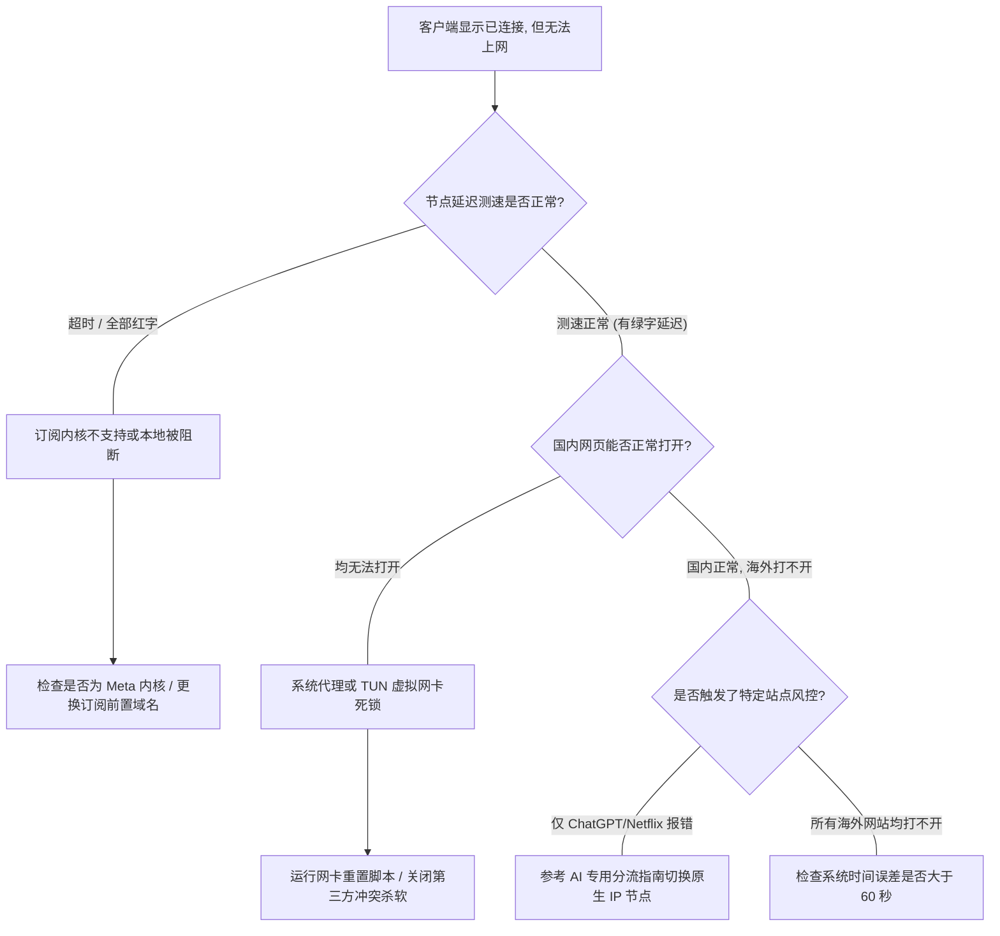

在跨境专线网络体系中，客户端是用户与底层物理骨干专线交互的直接窗口。为了兼顾“零门槛开箱即用”与“极客高级策略分流”，[Nexitally 官方网站](/) 提供了**全平台官方自研客户端**与**主流第三方客户端（Clash Verge / Shadowrocket / Surge）订阅导入**双轨支持体系。

无论您是在主力桌面端处理高吞吐跨国远程协作，还是在移动端维护高频 AI 会话，本篇实战手册将手把手指导您完成从节点订阅获取、客户端部署、TUN 虚拟网卡模式配置到网络故障自愈的完整操作。

---

## 核心速查（Answer Block）

> **问题：Nexitally 订阅导入第三方客户端（如 Clash Verge 或 Shadowrocket）显示成功，但打开网页无法联网或提示超时，最核心的原因是什么？**  
> **答案：** 最常见的核心诱因并非专线故障，而是**客户端核心与系统网络环境不适配**：  
> 1. 第三方客户端内核版本过旧，未能支持现代 VLESS 协议（如 Clash 需切换至支持现代协议的 Meta / Mihomo 内核）；  
> 2. 本地 DNS 发生污染，域名解析未进入代理链路；  
> 3. 系统代理与本地其他 VPN 或安全软件的虚拟网卡冲突。  
> 解决方案是检查内核版本，并在客户端设置中开启 **TUN 虚拟网卡模式** 与 **远程 DNS 解析**。用户也可随时前往 [专线节点实时服务状态监控](/status) 确认当前机房整体可用率。

---

## 一、客户端生态技术架构与选型决策

Nexitally 全系套餐均支持**不限制设备同时在线数量**。在选择客户端时，建议根据您的业务类型与技术习惯进行匹配：

| 客户端形态 | 适配操作系统 | 协议支持 | 核心优势 | 适用场景 |
| :--- | :--- | :--- | :--- | :--- |
| **Nexitally 官方自研客户端** | Windows / macOS / Android / iOS | 原生 VLESS 专线 | 开箱即用、一键测速、故障自愈、免配规则 | 日常办公、商务差旅、追求极致极简的新手用户 |
| **Clash Verge Rev (Mihomo 内核)** | Windows / macOS / Linux | VLESS / Trojan / SS | 强大的规则分流、TUN 模式深度接管、支持脚本覆写 | 软件工程师、跨境电商运营、需要终端环境加速的用户 |
| **Shadowrocket (小火箭)** | iOS / iPadOS | 全协议矩阵 | 稳定低耗电、支持按 SSID 分流、自动化规则更新 | iPhone 主力机、移动端跨境办公与海外社媒运维 |
| **Surge / Loon** | macOS / iOS | 高级网络调试 | 抓包排查、极致网络性能与低延迟调度 | 高级网络工程师与专业音频/视频创作者 |

> [!NOTE]
> 在配置前，请先确保已在 [Nexitally 专线套餐开通页面](/pricing) 完成账户订阅开通，并在控制台获取专属于您的动态订阅链接（严禁将个人订阅分享他人，以防触发安全风控）。

---

## 二、Nexitally 官方自研客户端极速上手（推荐）

自研客户端专为本站企业级专线与 [现代化 VLESS 协议性能调优实践](/blog/vless-protocol-advantages/) 量身设计，省去了复杂的 yaml 配置文件编辑环节。


### 1. Windows 平台安装与初次配置
1. 访问控制台中的软件下载中心，下载最新版 Windows 安装包（推荐 `.msi` 格式）。
2. 双击安装。如果遇到 Windows Defender SmartScreen 提示，点击“更多信息”并选择“仍要运行”（官方程序均经过严格的代码安全审查）。
3. 启动客户端，输入官网注册邮箱与密码进行身份鉴权。
4. **开启智能分流**：在主界面将路由模式设置为 `智能分流（Smart Rule）`。此时访问百度、微信等国内流量自动直连，访问 GitHub、Google、ChatGPT 则无缝走专线通道。

### 2. macOS 平台部署优化（Apple Silicon 与 Intel 双支持）
1. 下载适合您 Mac 架构的 `.dmg` 镜像文件（M1/M2/M3/M4 芯片选择 ARM64，Intel 芯片选择 x64）。
2. 将应用程序图标拖拽进 `Applications` 目录。
3. 首次启动时，macOS 会提示“系统扩展已被阻止”。进入系统设置 &rarr; `隐私与安全性`，找到安全提示并点击“允许”，以便客户端安装虚拟网络适配器。
4. 建议在首选项中开启“开机静默自启”与“异常断开自动重连”，保障后台长效在线。

### 3. 移动端（Android / iOS）保活设置
- **Android 端**：安装官方 APK 后，长按应用图标进入应用信息，关闭“电池优化”，并将后台限制设置为“无限制”，防止系统在锁屏时将代理进程挂起。
- **iOS 端**：按照控制台指引通过 TestFlight 或专属证书下载安装，安装后在系统弹窗中允许“添加 VPN 配置”，输入手机锁屏密码即可完成初始化。

---

## 三、第三方客户端深度实战：Clash Verge Rev 调优指南

对于需要深度定制分流规则或接管命令行终端（CMD / PowerShell / Terminal）的开发者，**Clash Verge Rev**（基于开源 Mihomo/Clash.Meta 内核）是当前最稳定强劲的跨平台选择。

### 1. 订阅导入与内核校验
1. 打开控制台的【订阅中心】，找到 Clash 订阅链接，点击“一键复制”。
2. 打开 Clash Verge Rev，点击左侧菜单栏的 `订阅（Subscription）`。
3. 在上方 URL 输入框中粘贴订阅地址，点击右侧的 `保存（Save）`，随后点击右下角刷新按钮下载节点。
4. **关键步骤（内核检查）**：进入 `设置（Settings）` &rarr; `Clash 内核`，务必确认内核类型为 **Mihomo (Meta)**。传统的原版 Clash 内核不支持 VLESS 协议，会导致所有节点显示 `Timeout`。

### 2. 激活 TUN 虚拟网卡模式（解决系统代理无法接管的死角）
普通系统代理仅对支持代理协议的浏览器生效，而对于终端 Git Clone、Docker、Node.js 依赖拉取、部分游戏客户端等往往无法起效。开启 TUN 模式可直接在网络层建立虚拟网卡，接管全系统所有出站流量：

1. 进入 Clash Verge Rev `设置` 界面。
2. 找到 `服务模式（Service Mode）`，点击右侧的 `安装（Install）`。安装成功后，旁边的盾牌图标将变为绿色激活状态。
3. 回到主界面，将 `TUN 模式` 开关切换为**开启**。
4. 此时您的系统网卡列表中将生成一张名为 `Mihomo` 的虚拟网络适配器，所有软件流量均受代理规则统筹。

```yaml
# Clash Verge 推荐 DNS 与 TUN 覆写配置片段 (Merge 模式)
dns:
  enable: true
  listen: :1053
  ipv6: false
  enhanced-mode: fake-ip
  fake-ip-range: 198.18.0.1/16
  nameserver:
    - 223.5.5.5
    - 119.29.29.29
  fallback:
    - https://1.1.1.1/dns-query
    - https://8.8.8.8/dns-query
```

---

## 四、iOS 端 Shadowrocket（小火箭）高效配置

小火箭是 iOS 平台久经考验的高性能网络工具，原生全面兼容 [Nexitally 核心 IEPL 物理专线架构](/blog/iepl-network-architecture/)。

### 1. 订阅配置与自动化更新
1. 在 iPhone Safari 浏览器打开控制台，点击“一键导入 Shadowrocket”，小火箭将自动唤醒并弹出“添加订阅”窗口。
2. 若手动导入：打开小火箭，点击右上角 `+` 号，类型选择 `Subscribe`，在 URL 一栏粘贴专属订阅，备注填写 `Nexitally 专线`，点击右上角保存。
3. **开启自动更新**：进入小火箭底部 `设置` &rarr; `订阅`，开启 `打开时更新` 与 `自动后台更新`，确保每当骨干机房进行动态负载调度时，您的本地节点库始终处于最新状态。

### 2. 路由分流与 DNS 泄漏防护
- **全局路由设置**：首页的全局路由必须设为 **配置（Config）**，切勿使用代理（Proxy）或全局（Global）。配置模式会自动依据域名列表智能分流，避免国内应用消耗套餐流量。
- **防止 DNS 污染**：在配置页面中，选择当前使用的规则文件，开启 `远程解析`，确保查询海外域名时由专线远端安全解析，彻底防范 [ChatGPT 与流媒体解锁风控拦截](/blog/ai-and-streaming-unlock/)。

---

## 五、连接故障诊断决策树与排错实战

当遇到网络无法连通时，请参照以下排查流程图，切忌盲目反复重装客户端：



### 常见核心错误排查实战

#### 1. 系统时间误差引发的 TLS 握手失败
由于现代 VLESS 协议基于标准的 TLS 1.3 通信握手，**客户端本地系统时间与国际标准时间偏差必须小于 60 秒**。如果时间误差过大，服务器证书鉴权将直接失败并断开连接。  
- **修复方法**：进入 Windows / macOS `日期和时间` 设置，点击“立即同步”，确保本地与 NTP 服务器时间完全一致。

#### 2. Windows 系统代理无法清理与注册表死锁
部分软件异常退出后可能残留无效的代理端口（如 `127.0.0.1:7890`），导致即便关闭客户端也无法上网。可通过 PowerShell 管理员运行以下重置命令：

```powershell
# Windows 网络与 WinINet 代理彻底清理脚本
netsh winsock reset
netsh int ip reset
reg add "HKCU\Software\Microsoft\Windows\CurrentVersion\Internet Settings" /v ProxyEnable /t REG_DWORD /d 0 /f
reg delete "HKCU\Software\Microsoft\Windows\CurrentVersion\Internet Settings" /v ProxyServer /f
Write-Host "本地代理与网络协议栈已成功重置，请重启计算机生效！" -ForegroundColor Green
```

---

## 六、2026 深度 FAQ（用户高频技术问答）

### Q1：自研客户端与 Clash / 小火箭相比，哪种更省电、更稳定？
**答：** 移动端（iOS / Android）首选官方自研客户端或小火箭。自研客户端针对 VLESS 协议进行了代码级轻量化剥离，移除了无用的统计常驻，在后台休眠时几乎零 CPU 唤醒；而桌面端若有复杂分流（如区分个人项目与工作流量），Clash Verge Rev 的可定制性更强。

### Q2：使用第三方客户端，订阅链接多长时间需要更新一次？
**答：** 建议将第三方客户端的自动更新间隔设置为 **12 小时至 24 小时**。Nexitally 核心骨干网会自动优化节点可用率，定期更新订阅可以及时获取新增的扩容专线，并剔除正在维护的海缆检修备用节点。

### Q3：为什么部分节点延迟显示非常低（如 15ms），但下载速度提不上去？
**答：** 客户端显示的延迟通常为“握手 RTT 时延”，代表数据从本地到机房来回的物理时间；而下载带宽吞吐取决于该节点的物理带宽与分流策略。Nexitally 全系节点提供最高 2.5Gbps 带宽，若遇测速偏慢，请检查是否误开启了软件层面的并发限速，或横向参考 [企业级 IEPL 物理专线拓扑原理解析](/blog/iepl-network-architecture/) 了解高峰期带宽分配机制。

### Q4：更换了手机或电脑，需要重新购买套餐吗？
**答：** 完全不需要。Nexitally 全系套餐均支持**不限制设备同时在线**。在新设备上只需安装好客户端并导入相同的订阅链接，即可立即接入专线，满足家庭办公与跨设备协同的多端使用需求。更多资费规则可查阅 [套餐资费详情说明](/pricing)。

---

## 七、延伸阅读与技术链路互联

- **物理层技术探秘**：了解您的数据是如何通过海底光缆实现极速直连的 &rarr; [企业级 IEPL 专线深度解析：为什么晚高峰依然稳如磐石？](/blog/iepl-network-architecture/)
- **协议层底层剖析**：深入探索免解密转发与极低 CPU 消耗机制 &rarr; [现代化 VLESS 协议核心优势与网络低开销调优实践](/blog/vless-protocol-advantages/)
- **业务场景进阶攻略**：突破平台边缘风控与解锁全画质影音 &rarr; [ChatGPT、Claude 与 Netflix 4K 原生流媒体解锁网络配置指南](/blog/ai-and-streaming-unlock/)
- **遇到无法解决的异常？**：登录控制台查看最新维护公告或提交工单 &rarr; [联系官方技术工程师支持](/contact)
