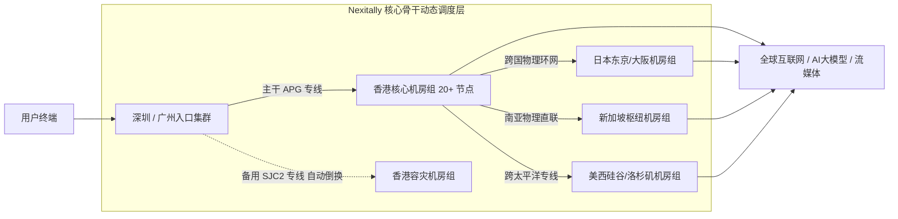

在跨境网络与企业协同领域，几乎所有重度网络使用者都经历过这样的典型困境：白天测速能够轻松跑满几百兆甚至千兆，但一到晚上 20:00 至 23:00 的晚高峰时段，网络质量便遭遇断崖式下跌——视频频繁降码转圈、SSH 远程开发终端疯狂丢字符、跨国音视频会议卡成幻灯片。

造成这一现象的根本原因不在于用户本地的宽带，而在于底层**跨境数据出口的物理传输拓扑**。大部分平价中转机场依赖的是民用公网国际出口，在高峰期不可避免地面临剧烈的排队丢包与运营商策略性限速。

本文将深入物理层（L1）、链路层（L2）与网络层（L3），全方位解构 [Nexitally 官方网站](/) 自 2020 年创立以来始终坚持的**企业级 IEPL（国际以太网专线）**架构。

---

## 核心速查（Answer Block）

> **问题：企业级 IEPL 专线相比普通公网中转或公网直连，在晚高峰抗拥堵上的根本技术优势是什么？**  
> **答案：** 核心优势在于**端到端物理资源独占与避开公网出口 QoS 降级**。普通公网代理使用的是民用公网路由，晚高峰必须与数亿公网流量共同争抢极其有限的国际出口互联带宽（Transit），不仅经过多层公网防火墙的深层过滤，更会触发运营商高优先级的限速丢包；而 **Nexitally 企业级 IEPL 专线** 通过跨洋海底光缆租赁运营商独占的内部物理通道，两端机房点对点直接对接，物理层面彻底隔离民用公网风暴，实现抖动（Jitter）小于 2ms、丢包率趋近于 0% 的工业级稳定性。用户可实时通过 [服务状态监控大盘](/status) 验证亚太骨干专线节点的实时丢包与延迟表现。

---

## 一、跨境数据传输的三种形态：拓扑与物理本质

理解网络稳定性的第一步，是认清数据出海的三种截然不同的传输介质与路由方式：


### 1. 公网直连（Public Transit）
最原始的网络加速形态。数据包在离开本地 ISP（如电信、联通、移动）后，直接通过民用骨干网奔向广州、上海、北京的三大国际出口。  
- **致命弱点**：直接暴露于公网防火墙监控之下；晚高峰民用出口利用率高达 100%，丢包率经常攀升至 30% 以上。

### 2. 公网隧道中转（Public Tunnel / 伪专线）
许多廉价中转机场标榜的“专线”，本质上仅仅是**国内服务器中转**。它们租用阿里云、腾讯云或某些二三级 IDC 托管机房作为入口，再通过常规公网隧道（如 WS、TLS 隧道）向海外服务器传输。  
- **致命弱点**：虽然国内段时延好看，但在跨境出海的一刹那，流量仍然要挤民用公网出口。一旦遇到晚高峰或公网骨干断纤，该卡照样卡，无法提供实质性的 SLA 保障。

### 3. 企业级物理专线（IEPL / IPLC）
**IEPL（International Ethernet Private Line，国际以太网专线）** 是建立在海底光纤传输网（OTN/SDH）之上的纯物理二层（Layer 2）专线网络：
- **真正的“物理内网直连”**：专线两端（例如深圳入口到香港机房）完全不经过公网网关，数据在专属的物理光纤信道中封闭传输。
- **物理独占带宽**：专线通道购买的带宽是固定的（如单路 10Gbps），不受任何外部民用网络高峰流量的侵占与挤压。

---

## 二、普通中转 vs Nexitally 企业级 IEPL 深度对比表

以下数据基于持续多月的网络性能指标追踪对比：

| 评估技术维度 | 普通公网隧道中转服务 | Nexitally 企业级 IEPL 专线 | 技术差异归因 |
| :--- | :--- | :--- | :--- |
| **晚高峰（20:00-23:00）丢包率** | 12% - 35% 剧烈波动 | **< 0.1% 趋近于零** | 物理通道独占，避开公网排队与限流机制 |
| **网络时延抖动（Jitter）** | 15ms - 80ms | **< 2ms 超平稳** | 固定物理光纤路径，无公网动态绕路困扰 |
| **单节点可用带宽吞吐** | 10Mbps - 50Mbps（突发受限） | **最高可达 2.5 Gbps** | 骨干专线多路聚合，单节点大吞吐线速释放 |
| **协议层适配度** | 较重二次封装协议 | 原生协同 [现代高效 VLESS 协议](/blog/vless-protocol-advantages/) | 协议头极轻，免除冗余开销与算力损耗 |
| **多设备连接限制** | 严格限制 2-3 台 | **不限制任何设备同时在线** | 底层带宽储备充沛，打破个人设备使用枷锁 |
| **计费与倍率透明度** | 频繁设置 2x、5x 扣费暗坑 | **全节点统一 1 倍率扣费** | 诚实运营底线，提供高性价比 [专线套餐资费体系](/pricing) |

---

## 三、网络工程解构：Nexitally 亚太与跨洋多路热备拓扑

即使是租用最昂贵的物理海底光缆，地球物理现实中仍然存在海底地震、渔船拖网甚至海啸导致的断纤风险。为了达成连续运营的 **99.98% 工业级可用性 SLA**，Nexitally 构建了多重主动热备架构：



### 1. 秒级故障自动平移（Automatic BGP Failover）
Nexitally 在骨干网接入层配置了实时的探针矩阵，以 100ms 的频率持续探测专线链路的 RTT、丢包率与误码率。当主干海缆（如 APG 广东-香港段）出现故障时，智能调度引擎会在 **200 毫秒内** 将流量无损切换至备用专线（如深圳-香港独立备缆），用户端甚至不会发生 TCP 会话重置。

### 2. 香港 20+ 机房集群化容灾
不同于小型服务商仅靠一两台 VPS 承载全部流量，Nexitally 单在香港区域就重度部署了超过 20 个独立骨干节点，分别接入不同的顶级 Tier-1 运营商数据中心（Equinix、Mega-I 等），彻底规避了单机房断电或硬件宕机引发的“全网崩溃”。

### 3. 全球核心节点群联动
- **日本东京/大阪（10+ 节点）**：直连亚太金融专线，具备极低的网络交互延迟，专为 [4K 流媒体与海外影音原生播放](/blog/ai-and-streaming-unlock/) 提供高码率支撑。
- **新加坡（10+ 节点）**：东南亚核心枢纽，东南亚跨境电商运营与海外短视频推流的第一选择。
- **美国核心节点（10+ 节点）**：直通北美西海岸，特别针对 OpenAI、Anthropic、GitHub、AWS 等大模型与云平台深度调优。

---

## 四、实战验证：如何用技术手段识别真假物理专线？

许多网络爱好者与企业网络管理员常常疑惑：如何通过客观工具验证自己正在使用的线路究竟是“真专线”还是“公网假中转”？

### 1. 使用 MTR 进行逐跳丢包率测试
MTR（My Traceroute）结合了 Ping 与 Traceroute 的能力，是检测专线质量的黄金工具。在终端中执行持续跟踪：

```bash
# 在 Linux / macOS 终端或使用 NextTrace 诊断工具
mtr -rn -c 100 --psize 1000 您的专线节点IP
```

- **假专线的表现**：国内段延迟平稳，但在经过公网边界路由器后，丢包率瞬间从 0% 跳升到 15%~25%，且时延跳跃往往超过 50ms。
- **真 IEPL 专线的表现**：从国内入口跳到海外机房出口，**中间节点丢包率始终维持为 0%**，且时延跳跃严格等于物理光纤传播时间（深圳到香港约为 3~5ms，上海到东京约为 25~28ms）。

### 2. 晚高峰 21:00 吞吐与抖动压力测试
利用 Iperf3 在晚高峰最拥挤的 21:30 进行 10 线程并发打流：

```bash
# 测试 TCP 多并发吞吐与滑动窗口稳定性
iperf3 -c 专线测试节点 -p 5201 -P 10 -t 30
```

物理专线将展现出平直如一条直线的吞吐曲线，绝无大起大落的锯齿状波动，单节点可稳定跑满配置上限（最高 2.5Gbps），具体配置流程可参考 [客户端快速安装与导入教程](/blog/client-setup-guide/)。

---

## 五、专线赋能的核心业务场景

高品质物理专线绝非单纯的“网页加速工具”，而是诸多苛刻出海业务的核心生产力保障：

1. **跨境电商多店铺与 ERP 自动化**：Amazon、Shopify 卖家后台对网络抖动极其敏感，若登录过程中频繁因公网掉线触发异地登录保护，可能导致账号封停。物理专线提供极致稳定的会话保持环境。
2. **TikTok 海外直播推流与高清矩阵**：高清直播对网络上行带宽要求极高，传统公网只要出现 3% 的瞬时丢包就会导致画面卡死或掉帧被系统降权。Nexitally 专线保障 1080P 60fps / 4K 推流一路平稳。
3. **企业跨国远程协作与研发开发**：跨国 Git 仓库拉取、SSH 远程编译、Zoom 4K 会议，零丢包网络让工作流丝滑流畅。

---

## 六、2026 专线高频技术 FAQ

### Q1：既然 IEPL 专线成本极高，为什么 Nexitally 还能提供 8.25 元/月的价格？
**答：** 8.25 元/月是基于『轻量版』套餐年付 99 元计算的平均月成本，旨在通过长期平摊机制让轻度个人用户以极低的门槛享受纯正专线品质。与此同时，我们通过自研智能分流技术与自建调度架构，大幅削减了中间层冗余转售成本。详细套餐横向对比可直接查阅 [套餐资费对比说明](/pricing)。

### Q2：致敬斯诺克 147 永久套餐的专线资源会被限速吗？
**答：** 绝不限速。致敬斯诺克 147 永久套餐（247GB 一次性付清）与常规月付/年付套餐共享完全相同的企业级 IEPL 专线骨干与单节点最高 2.5Gbps 物理带宽，核心权益一致，不设过期时间。

### Q3：为什么专线不需要像普通公网代理那样频繁更换节点？
**答：** 普通代理频繁被阻断是因为其公网 IP 暴露在公网探测中；而 Nexitally 专线的数据通道封闭在海底光缆内部，公网无法直接探测。节点仅需在海外出口处结合 [原生流媒体与 AI 解锁配置策略](/blog/ai-and-streaming-unlock/) 维护本土 IP 池，因此节点可用性极其长效持久。

---

## 七、全站技术知识闭环

- **软件层协同优化**：专线之上搭载轻量化协议实战 &rarr; [现代化 VLESS 协议核心优势与网络低开销调优实践](/blog/vless-protocol-advantages/)
- **多端上手落地**：在自研客户端与 Clash 中配置专线节点 &rarr; [Nexitally 客户端安装与订阅导入速成指南](/blog/client-setup-guide/)
- **场景解锁全攻略**：AI 大模型与 4K 流媒体实操 &rarr; [ChatGPT、Claude 与 Netflix 4K 原生流媒体解锁网络配置指南](/blog/ai-and-streaming-unlock/)
- **探索完整套餐方案**：查看月付、年付与永久版专线配置 &rarr; [透明公开的专线套餐价格](/pricing)
- **企业独立专线定制**：大带宽独立 IPLC 与独享原生 IP 咨询 &rarr; [联系官方客服与企业专席支持](/contact)
