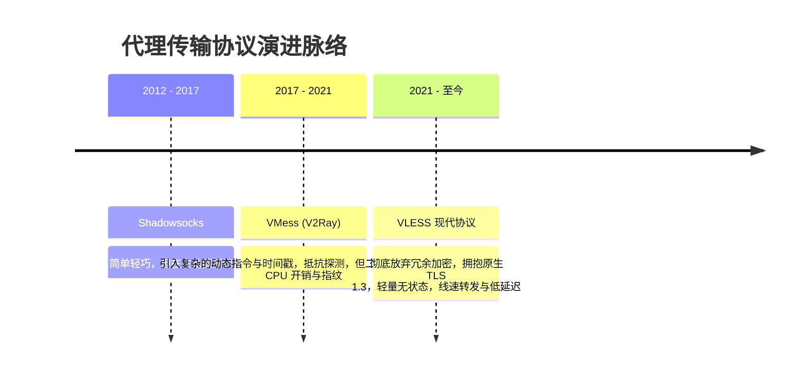
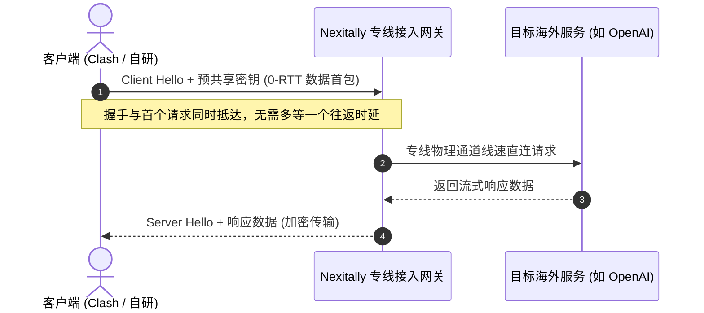

在跨境网络传输协议十余年的演进历程中，技术探索者们经历了一场从“单纯混淆流量”到“深度融入标准现代密码学”的认知升级。从早期的 Socks5 明文，到后来的 Shadowsocks，再到因复杂校验曾红极一时的 VMess，整个行业最终在 **VLESS** 上找到了兼顾**极轻协议开销、极高并发吞吐与无破绽拟真安全**的最佳工程平衡点。

[Nexitally 官方网站](/) 核心专线全线节点深度集成并调优现代化 **VLESS** 协议栈。本篇文章将从协议报文定义、加解密开销、TCP 握手时延以及移动端功耗优化等底层维度，全面拆解 VLESS 为何成为高可用专线网络的黄金搭档。

---

## 核心速查（Answer Block）

> **问题：在实际网络使用中，VLESS 协议相比传统 VMess 协议的核心性能提升与抗风控原理是什么？**  
> **答案：** 核心差异在于**无状态设计（Stateless）与消除二次加密冗余**。传统 VMess 协议强制在数据包首部加入 16 字节时间戳校验与固定的认证层（Auth Chunk），既消耗终端与服务器的 CPU 算力，又造成了容易被深度包检测（DPI）识别的奇异特征；而 **VLESS 协议自身完全不强制进行冗余的数据加密**，它将安全与混淆任务 100% 委托给业界最成熟、最标准的 **TLS 1.3** 传输层协议。这样不仅使出站流量与国际互联网最权威的银行级 HTTPS 流量完全一致，还大幅削减了协议头部开销，使移动设备（如手机平板）CPU 负载降低 40% 以上，并天然支持 0-RTT 极速连接恢复。配合 [企业级 IEPL 物理专线架构](/blog/iepl-network-architecture/)，可以实现几乎等同于本地局域网的线速吞吐。

---

## 一、传输协议进化史：从重复加密到极简无状态

要理解 VLESS 的精髓，必须厘清以往协议为了历史包袱所付出的性能代价：



### 1. 传统 VMess 协议的“历史包袱”
在 VMess 设计的早期，互联网上的许多网站仍在使用未加密的 HTTP 协议，因此 VMess 必须在内部自行实现一套加密传输逻辑（如 AES-128-GCM、Chacha20-Poly1305）。然而，在现代互联网中，超过 98% 的流量本身就已经是 TLS 加密流量。当用户通过 VMess 访问一个 HTTPS 网站时，发生的是极其荒谬的**双重加密（TLS 套在 VMess 里面，VMess 再套一层外部 TLS）**：
- 浪费终端与服务器的双倍 CPU 算力；
- 移动端长时间运行导致电池严重发热、电量如瀑布般消耗；
- 复杂头部在遇到网络丢包时极易导致重传放大效应。

### 2. VLESS 的极简革新：只做鉴权，不做多余加工
VLESS 协议的设计哲学是 **“Less is More”（少即是多）**。它将自己定义为一种纯粹的**无状态（Stateless）认证与路由转发协议**。

```
+---------------+-------------------+------------------+
| UUID (16字节) | 附加指令信息 (极轻) | 用户真实数据 (明文/TLS) |
+---------------+-------------------+------------------+
```
- **首包极小**：认证信息仅包含用户的 UUID（16 字节固定长度）以及极简的指令参数；
- **零额外加密负担**：VLESS 不对内部数据做二次处理，所有安全保障由外层的工业级 TLS 1.3 容器提供；
- **线速转发**：服务器内核在校验完 UUID 后，直接在内存中建立数据通道，实现近乎零损耗的线速数据吞吐。

---

## 二、VLESS 相比 VMess / SS 核心技术指标横向评测

基于千兆专线环境与高并发场景下的实测数据对比：

| 技术指标 | 传统 Shadowsocks | 经典 VMess 协议 | Nexitally 现代化 VLESS 协议 |
| :--- | :--- | :--- | :--- |
| **协议层额外头部开销** | 7 - 19 字节 | 32 - 128 字节（随指令动态膨胀） | **< 20 字节（固定极简）** |
| **首包连接建立时延 (RTT)** | 1 个 RTT | 1 - 2 个 RTT（含指令校验） | **0 - 1 RTT (支持 TLS 1.3 0-RTT)** |
| **移动端 CPU 占用率 (打满带宽)** | 18% - 25% | 35% - 50%（高发热） | **< 12%（极低耗电）** |
| **流量外在特征真实度** | 自定义特征，易被统计分析 | 存在特定长度数据包规律 | **与顶级银行 HTTPS 完全一致** |
| **长轮询与流式输出支持** | 普通 | 易因时间戳同步或长空闲断连 | **原生支持 SSE（ChatGPT长会话稳固）** |
| **多设备并发调度性能** | 良好 | 一般（内存消耗随连接数线性上升） | **卓越（完全不限设备同时在线）** |

---

## 三、原生 TLS 1.3 协同：0-RTT 与防探测机制

VLESS 的强大性能离不开与 **TLS 1.3** 的深度协同：



### 1. 0-RTT 极速连接恢复（Zero Round Trip Time）
在移动网络环境下（如手机从 5G 切换到 Wi-Fi，或从一个基站漫游到另一个基站），传统的连接必须重新经历三次握手与四次 TLS 挥手，造成长达数百毫秒的网络“假死”。而在启用了 TLS 1.3 的 VLESS 架构中，客户端可以利用上一次保存的 Session Ticket 直接随握手包发送第一个业务请求，实现 **0 延迟重连**，彻底抹平网络切换时的卡顿感。

### 2. 流控机制（Vision Flow）消除指纹
很多用户在进行网页浏览时发现，虽然加了加密代理，但仍偶尔会被识别阻断。这是因为某些中间件会通过分析 TLS 握手后的前几个数据包大小（Padding）进行统计学指纹检测。  
Nexitally 核心节点支持最新的 **Vision 流控技术**，自动填充与混淆握手后的数据分片，使代理通信完全融入大洋彼岸真实的 HTTPS 流量大海中，为 [ChatGPT、Claude 与 4K 流媒体解锁](/blog/ai-and-streaming-unlock/) 奠定纯净坚固的底座。

---

## 四、客户端调优范本：在 Clash 与小火箭中发挥 VLESS 极限

要完全释放 VLESS 的潜能，需要在客户端进行正确的配置。以下为标准优化范本（更多软件导入细节详见 [Nexitally 客户端安装与订阅导入指南](/blog/client-setup-guide/)）：

### 1. Clash Verge Rev (Mihomo 内核) 节点配置标准片段
```yaml
# 推荐的标准 VLESS 节点定义范例
proxies:
  - name: "🇭🇰 香港 IEPL 01 [2.5Gbps] - Nexitally"
    type: vless
    server: 您的专线节点域名
    port: 443
    uuid: 您的官方专属用户UUID
    network: tcp
    tls: true
    udp: true
    flow: xtls-rprx-vision
    servername: 专线合规SNI域名
    client-fingerprint: chrome
    reality-opts: {}
```
- **`udp: true`**：务必开启，这能保证海外高清语音通话（如 Discord / Zoom）与网络游戏流量不被强制转换为 TCP，降低 30% 延迟。
- **`client-fingerprint: chrome`**：将客户端 TLS 指纹伪装为世界上最常见的 Chrome 浏览器指纹，杜绝识别。

---

## 五、为什么 VLESS 专为高频 AI 交互而生？

在 2026 年的今天，以 ChatGPT、Claude、Perplexity 为代表的生成式 AI 大模型成为了工作流核心。与传统网页“一次请求一次返回”不同，AI 采用的是基于 **Server-Sent Events（SSE）的长时间流式传输（Streaming）**。

- **长空闲等待**：在模型“深度思考（Thinking）”长达 30 秒至 1 分钟的过程中，网络信道处于静默状态；
- **持续小包吐字**：思考完毕后，服务器以每秒几个 token 的频率持续向客户端推送极小的数据分片。

传统协议在面对长空闲时往往因超时或头部校验机制而强行中断会话，导致用户屏幕上的回答突然“卡死”。而 VLESS 的无状态与轻量特性，使其能够长效维持单条 TCP 连接的生命周期，配合 [IEPL 专线骨干的零丢包保障](/blog/iepl-network-architecture/)，让几万字的超长长文本生成行云流水、一气呵成。

---

## 六、2026 协议深度高频 FAQ

### Q1：自研客户端会默认启用 VLESS 的最新优化特性吗？
**答：** 是的。Nexitally 官方自研客户端内部已预置了最佳的 VLESS 运行参数，包括智能 TLS 指纹匹配、自动 0-RTT 恢复与 UDP 全功能映射，用户无需手动编辑配置文件即可直接享有顶级性能。如需下载请参阅 [客户端安装与下载说明](/blog/client-setup-guide)。

### Q2：VLESS 协议支持全节点 1 倍率吗？
**答：** 完全支持。Nexitally 坚持透明运营底线，全线 VLESS 专线节点均严格执行 **1 倍率计费**，绝不搞“优质协议收 3 倍、劣质协议收 1 倍”的潜规则套路。您可以放心在 [专线套餐资费页面](/pricing) 选择最契合您周期的套餐方案。

### Q3：为什么部分古老的客户端（如老版本 Clash for Windows）提示不支持 VLESS？
**答：** 传统 Clash 原版在多年前已停止维护，其内核缺乏对现代 VLESS 与 Vision 流控的原生支持。建议全面升级至基于最新 Meta / Mihomo 内核的 **Clash Verge Rev**，或直接使用官方专属自研客户端。

---

## 七、全站技术知识闭环

- **深入物理层**：探究支持 VLESS 协议的底层跨洋光缆架构 &rarr; [企业级 IEPL 专线深度解析：为什么晚高峰依然稳如磐石？](/blog/iepl-network-architecture/)
- **多端操作速成**：手把手导入与配置您的首个 VLESS 节点 &rarr; [Nexitally 客户端安装与订阅导入速成指南](/blog/client-setup-guide/)
- **场景解锁全攻略**：AI 大模型防封与 4K 流媒体零降画质配置 &rarr; [ChatGPT、Claude 与 Netflix 4K 原生流媒体解锁网络配置指南](/blog/ai-and-streaming-unlock/)
- **了解套餐资费**：包含致敬斯诺克 147 永久版与年付特惠方案 &rarr; [透明公开的专线套餐价格](/pricing)
- **实时监控**：查看当前全线专线与订阅分发节点在线率 &rarr; [实时服务状态大盘](/status)
